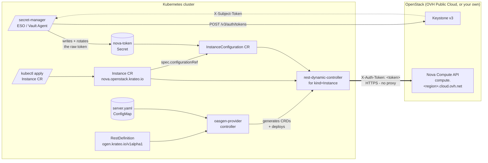

# Architecture



## Component summary

| Component | Source | Role |
|---|---|---|
| `oasgen-provider` | Krateo upstream Helm chart | Reads RestDefinitions and the OAS, generates the `Instance` + `InstanceConfiguration` CRDs and deploys a dedicated `rest-dynamic-controller` to reconcile them. |
| `RestDefinition` (this chart) | `chart/templates/rd-server.yaml` | Declarative pointer to the Nova OAS subset + the verbs we want exposed (`create`, `get`, `delete`). The CRD Kind is `Instance` (configurable; must not be `Server` — see below). |
| Nova OAS subset (this chart) | `chart/assets/server.yaml` | OpenAPI 3.0 with `http/bearer` security and the wrapped `{ "server": {...} }` envelope Nova expects. |
| `InstanceConfiguration` CR (auto-generated) | `chart/samples/nova-auth.yaml` | KOG-generated configuration CR; `spec.authentication.bearer.tokenRef` references the Secret holding the pre-fetched Keystone token. |
| `Instance` CR (auto-generated) | `chart/samples/test-server.yaml` | Concrete instance request (`spec.server.*` plus `spec.configurationRef`); reconciled into a Nova VM. |
| `scripts/get-token.sh` | this repo | Out-of-band Keystone token fetch helper; emits a `kubectl apply`-ready Secret. |

## How authentication works (and why there is no proxy)

Nova authenticates with a Keystone-issued token carried in a custom
`X-Auth-Token` header. OpenAPI models precisely that as an `apiKey`
scheme, and this chart's OAS subsets declare it directly:

```yaml
securitySchemes:
  apiKey:
    type: apiKey
    in: header
    name: X-Auth-Token
```

`oasgen-provider` (>= 0.20.0) generates an `APIKeyAuth` block onto the
`<Kind>Configuration` CRD from that scheme:

```yaml
spec:
  authentication:
    apiKey:
      tokenRef: {name, namespace, key}   # the RAW token value, no prefix
      header: X-Auth-Token               # defaulted from the OAS, but visible
```

and `rest-dynamic-controller` sets the header on each outgoing request
(`case auth.AuthTypeAPIKey` in
`go/rest-dynamic-controller/internal/tools/definitiongetter/getter.go`).
The controller talks to Nova directly; nothing sits in the request path.

Two deliberate details inherited from upstream:

- **The Secret holds the credential value only**, with no `Bearer `
  prefix and no HTTP framing. That is what lets a rotation path write it
  without knowing how the credential is sent. (`valuePrefix` exists for
  APIs that declare `apiKey` but want a prefix; for Keystone it stays
  empty.)
- **`header` is a real CR field, not a hidden constant.** It is defaulted
  from the scheme's declared name when the document is unambiguous, but
  surfaced so the derived value is visible when debugging a 401.

### Historical note: the auth bridge

Earlier revisions of this chart deployed `nova-auth-bridge`, a stateless
~30-line nginx config that rewrote `Authorization: Bearer <t>` into
`X-Auth-Token: <t>`. It existed because the generator then accepted only
`http/basic` and `http/bearer`, so the OAS had to lie about how Nova
authenticates and something had to correct the lie on the wire. With
`apiKey` support upstream the OAS can state the requirement honestly, and
the proxy — along with its Deployment, Service, ConfigMap and the
`authBridge.*` values — has been deleted.

### Token rotation is not this chart's job

Keystone tokens expire (~1h on OVH). Rotation belongs to a
**secret-manager**: point External Secrets Operator, Vault Agent, or your
platform's equivalent at the `nova-token` Secret and let it own minting
and refresh. The chart ships no CronJob, no sidecar and no refresh logic
deliberately — a timer that rewrites a Secret is off the request path and
fails visibly as 401s, which is a materially different thing from an
in-path proxy, and it is a solved problem that does not belong in an
operator package.

## Why is the Kind `Instance` and not `Server`?

Nova's create payload wraps everything in a `{ "server": {...} }`
envelope, so the OAS request body has a top-level property named
`server` and the generated CR spec therefore has `spec.server`. If the
CRD Kind is also `Server`, `crdgen` (the schema-to-CRD generator inside
`oasgen-provider`) conflates the `server` property with the managed
`Server` type and scaffolds it as a full Kubernetes object, emitting an
empty-`type` `spec: {}` node. The API server then rejects the CRD:

```
spec.validation.openAPIV3Schema.properties[spec].properties[server].properties[spec].type:
  Required value: must not be empty for specified object fields
```

The `server` property name is mandated by Nova, so the fix is to name
the Kind something else. The chart defaults to `Instance`
(`restdefinitions.server.resourceKind`), which yields
`instances.nova.openstack.krateo.io` and the companion
`instanceconfigurations.nova.openstack.krateo.io`.

## Why the `server.*` identifiers and `requestFieldMapping`

The same `{ "server": {...} }` envelope wraps Nova's *responses*. The
`rest-dynamic-controller` extracts the configured `identifiers` from the
response body by JSONPath and would, by default, look for `id`/`name` at
the root — where Nova has nothing. So the RestDefinition uses
`identifiers: [server.id, server.name]` (and `additionalStatusFields:
server.*`), which land in the CR as `status.server.id`, etc.

Path parameters are only auto-filled from *top-level* CR fields, so the
`{id}` in `GET`/`DELETE /servers/{id}` can't be sourced from the nested
`status.server.id` automatically. The `get` and `delete` verbs therefore
declare an explicit `requestFieldMapping` (`inPath: id` ←
`inCustomResource: status.server.id`). Without these two pieces the
create succeeds but the server id is never captured, so observe/delete
hit `/servers/{id}` literally (404) and the CR can neither report status
nor be cleaned up.
