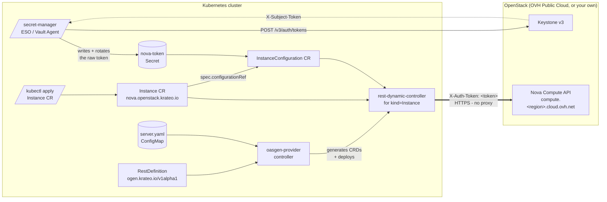

# Architecture



## Component summary

| Component | Source | Role |
|---|---|---|
| `oasgen-provider` | Krateo upstream Helm chart | Reads RestDefinitions and the OAS, generates the `Instance` + `InstanceConfiguration` CRDs and deploys a dedicated `rest-dynamic-controller` to reconcile them. |
| `RestDefinition` (this chart) | `chart/templates/rd-server.yaml` | Declarative pointer to the Nova OAS subset + the verbs we want exposed (`create`, `get`, `delete`). The CRD Kind is `Instance` (configurable; must not be `Server` — see below). |
| Nova OAS subset (this chart) | `chart/assets/server.yaml` | OpenAPI 3.0 with an `apiKey` security scheme (`in: header`, `name: X-Auth-Token`) and the wrapped `{ "server": {...} }` envelope Nova expects. |
| `InstanceConfiguration` CR (auto-generated) | `chart/samples/nova-auth.yaml` | KOG-generated configuration CR; `spec.authentication.apiKey.tokenRef` references the Secret holding the pre-fetched Keystone token. |
| `Instance` CR (auto-generated) | `chart/samples/test-server.yaml` | Concrete instance request (`spec.server.*` plus `spec.configurationRef`); reconciled into a Nova VM. |
| `scripts/get-token.sh` | this repo | Out-of-band Keystone token fetch helper; emits a `kubectl apply`-ready Secret. |

## How authentication works (and why there is no proxy)

Nova authenticates with a Keystone-issued token carried in a custom
`X-Auth-Token` header. OpenAPI models precisely that as an `apiKey`
scheme, and this chart's OAS subsets declare it directly:

```yaml
securitySchemes:
  apiKey:
    type: apiKey
    in: header
    name: X-Auth-Token
```

> [!IMPORTANT]
> **A security scheme, not a header parameter — and the difference is a
> structural immunity, not a stylistic preference.** The same `in: header` can
> appear in two places in an OAS document, and only one of them works.
>
> The openstack-ironic-operator-kog session measured the other one: for a header
> **parameter**, the value can be **dropped with no error** — the request leaves
> without it, and their workaround is to pin it as a static per-verb header on the
> RestDefinition instead. Tracked upstream as
> [oasgen-provider#561](https://github.com/krateo-platformops/oasgen-provider/issues/561).
>
> **The symptom is measured; the cause is open — and an earlier version of this
> page asserted one it should not have.** It said the provider emits the property
> as `header` (singular) while the controller reads `headers` (plural), so the
> lookup misses. **That does not survive a source read: both sides use the same
> spellings.** It came from a comment in the reporting repo rather than from the
> code, reached me as a finding, and I put it in a document and in a CI guard's
> docstring. That session retracted it unprompted. A plausible mechanism attached
> to a real symptom is the harder thing to catch, because the symptom keeps
> vouching for it.
>
> This chart's credential is a `type: apiKey` security scheme, so the provider
> attaches it through its own auth path and **never enters the parameter-header
> code at all**. That is why we are unaffected — a property of the shape, not an
> accident of what we happen to have written. Had we declared `X-Auth-Token` as
> a required header parameter instead, oasgen-provider#391 would also have
> refused the request outright with `missing header: X-Auth-Token`, because its
> exemption matches only names containing "authorization".
>
> `scripts/validate.py` enforces it: `verify_no_header_parameters_in_assets`
> refuses any `in: header` in `chart/assets/` that lacks a sibling
> `type: apiKey`. The screen exists because "we grepped and found none"
> describes today, while the structural claim is what actually protects us —
> credit to that session for drawing the distinction.

> [!WARNING]
> **The generated auth block carries a `default`, and a default materialises.**
> Measured on the generated CRDs, all six `<Kind>Configuration` kinds:
>
> ```
> <Kind>Configuration v1alpha1  spec.authentication.apiKey.header  type=string  default='X-Auth-Token'
> ```
>
> The API server stamps that onto every Configuration CR at admission, so
> `spec.authentication.apiKey.header` exists on objects that never set it. Benign
> today — it is exactly the value the security scheme declares — but it is not
> inert: **if the scheme's `name` ever changes, the old default stays on existing
> CRs.** Reverting the CRD does not remove a materialised value, and it is
> unowned, so `kubectl apply` will not prune it. Changing that header name on a
> live installation means editing the CRs, not just the document.
>
> Our two `additionalProperties=schema` emissions (`Instance.spec.server.metadata`
> and `Instance.status.server.addresses`) are the other generated shape worth
> knowing about; neither carries a default.
>
> **AND THE WORST VERSION OF THIS CANNOT OCCUR, which the provider's
> maintainers confirmed from source.** The irreversible shape is not a leaf
> default like ours — it is `default: {}` on an optional *object parent* that
> has a defaulted child, because the API server then materialises the whole
> object. Checked on their side: `render.go` passes `NoParentDefaults: true` at
> **both** render call sites unconditionally, and a shipped CRD carries **zero**
> object-typed defaults. So our six leaf defaults are the intended behaviour of
> `applyAPIKeyHeaderDefault` — pinned by their
> `TestApiKeyHeaderIsBothRequiredAndDefaulted` — and the parent-default shape
> does not arise. The field is deliberately both **required and defaulted**, so
> a Configuration that omits it is defaulted to the scheme's declared name and
> then passes the required check: the default is what makes a required field
> effectively optional.
>
> `hack/crd-shape.py --self-test` asserts that an empty object default would
> still be *visible* if one ever appeared, since `default={}` rendering as
> nothing would make a version diff report "no new defaults" for the one change
> that cannot be undone.
>
> **I claimed for several hours that these documents generate no defaults at all.**
> That was read off a fingerprint produced by a build of `hack/crd-shape.py` from
> before it tracked the keyword — its zeros meant "this build cannot see defaults",
> not "there are none". The script stamps its keyword set on line 1 precisely so
> that is visible, and the file in question had no stamp. The device worked; I did
> not read it.

`oasgen-provider` (**0.52.0, or >= 0.54.1 — not 0.53.0 or 0.54.0**) generates an `APIKeyAuth` block onto the
`<Kind>Configuration` CRD from that scheme:

```yaml
spec:
  authentication:
    apiKey:
      tokenRef: {name, namespace, key}   # the RAW token value, no prefix
      header: X-Auth-Token               # defaulted from the OAS, but visible
```

and `rest-dynamic-controller` sets the header on each outgoing request
(`case auth.AuthTypeAPIKey` in
`go/rest-dynamic-controller/internal/tools/definitiongetter/getter.go`).
The controller talks to Nova directly; nothing sits in the request path.

Two deliberate details inherited from upstream:

- **The Secret holds the credential value only**, with no `Bearer `
  prefix and no HTTP framing. That is what lets a rotation path write it
  without knowing how the credential is sent. (`valuePrefix` exists for
  APIs that declare `apiKey` but want a prefix; for Keystone it stays
  empty.)
- **`header` is a real CR field, not a hidden constant.** It is defaulted
  from the scheme's declared name when the document is unambiguous, but
  surfaced so the derived value is visible when debugging a 401.

### Historical note: the auth bridge

Earlier revisions of this chart deployed `nova-auth-bridge`, a stateless
~30-line nginx config that rewrote `Authorization: Bearer <t>` into
`X-Auth-Token: <t>`. It existed because the generator then accepted only
`http/basic` and `http/bearer`, so the OAS had to lie about how Nova
authenticates and something had to correct the lie on the wire. With
`apiKey` support upstream the OAS can state the requirement honestly, and
the proxy — along with its Deployment, Service, ConfigMap and the
`authBridge.*` values — has been deleted.

### Token rotation is not this chart's job

Keystone tokens expire (~1h on OVH). Rotation belongs to a
**secret-manager**: point External Secrets Operator, Vault Agent, or your
platform's equivalent at the `nova-token` Secret and let it own minting
and refresh. The chart ships no CronJob, no sidecar and no refresh logic
deliberately — a timer that rewrites a Secret is off the request path and
fails visibly as 401s, which is a materially different thing from an
in-path proxy, and it is a solved problem that does not belong in an
operator package.

## Why is the Kind `Instance` and not `Server`?

Nova's create payload wraps everything in a `{ "server": {...} }`
envelope, so the OAS request body has a top-level property named
`server` and the generated CR spec therefore has `spec.server`. If the
CRD Kind is also `Server`, `crdgen` (the schema-to-CRD generator inside
`oasgen-provider`) conflates the `server` property with the managed
`Server` type and scaffolds it as a full Kubernetes object, emitting an
empty-`type` `spec: {}` node. The API server then rejects the CRD:

```
spec.validation.openAPIV3Schema.properties[spec].properties[server].properties[spec].type:
  Required value: must not be empty for specified object fields
```

The `server` property name is mandated by Nova, so the fix is to name
the Kind something else. The chart defaults to `Instance`
(`restdefinitions.server.resourceKind`), which yields
`instances.nova.openstack.krateo.io` and the companion
`instanceconfigurations.nova.openstack.krateo.io`.

## Why the `server.*` identifiers and `requestFieldMapping`

The same `{ "server": {...} }` envelope wraps Nova's *responses*. The
`rest-dynamic-controller` extracts the configured `identifiers` from the
response body by JSONPath and would, by default, look for `id`/`name` at
the root — where Nova has nothing. So the RestDefinition uses
`identifiers: [server.id, server.name]` (and `additionalStatusFields:
server.*`), which land in the CR as `status.server.id`, etc.

Path parameters are only auto-filled from *top-level* CR fields, so the
`{id}` in `GET`/`DELETE /servers/{id}` can't be sourced from the nested
`status.server.id` automatically. The `get` and `delete` verbs therefore
declare an explicit `requestFieldMapping` (`inPath: id` ←
`inCustomResource: status.server.id`). Without these two pieces the
create succeeds but the server id is never captured, so observe/delete
hit `/servers/{id}` literally (404) and the CR can neither report status
nor be cleaned up.
