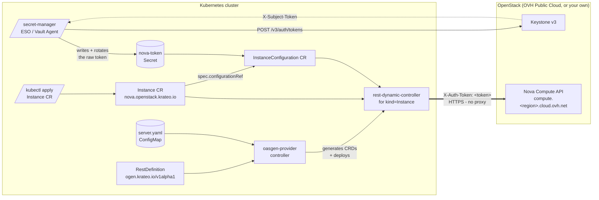

# Architecture



## Component summary

| Component | Source | Role |
|---|---|---|
| `oasgen-provider` | Krateo upstream Helm chart | Reads a RestDefinition and its OAS document, generates a CRD **named after that RestDefinition's `spec.resource.kind`** — plus a `<Kind>Configuration` CRD **when** the kind declares `configurationFields` or the document declares a security scheme — and deploys one dedicated `rest-dynamic-controller` Deployment per RestDefinition to reconcile instances of that kind. |

> **What that means here, measured rather than assumed.** This chart ships six
> RestDefinitions, so six pairs — and the kinds are **not** uniform, because
> `crdgen` collides a Kind with a same-named property in the generated spec and
> every Nova payload is envelope-wrapped:
>
> | asset | `resourceKind` | why not the obvious name |
> |---|---|---|
> | `server.yaml` | **`Instance`** | a Kind named `Server` collides with the `{"server": {…}}` envelope's own `server` property, and crdgen emits an empty-type node the API server rejects |
> | `flavor.yaml` | `ComputeFlavor` | same collision via `flavor` |
> | `keypair.yaml` | `ComputeKeypair` | same via `keypair` |
> | `server-group.yaml` | `ComputeServerGroup` | same via `server_group` |
> | `aggregate.yaml` | `ComputeAggregate` | same via `aggregate` |
> | `quota.yaml` | `ComputeQuota` | same via `quota_set` |
>
> **And all six Configuration CRDs exist only because of the security scheme.**
> Counted across `chart/assets/*.yaml`: `securitySchemes` appears in **6 of 6**
> documents and `configurationFields` in **0 of 6**. So by the condition above,
> every `<Kind>Configuration` here is generated by the *second* clause alone.
> That is a real dependency and not trivia: the Configuration CRD is **where the
> credential lives**, so a document that dropped its `apiKey` scheme would get no
> Configuration CRD and this chart's whole auth model would have nowhere to sit.
| `RestDefinition` (this chart) | `chart/templates/rd-server.yaml` | Declarative pointer to the Nova OAS subset + the verbs we want exposed (`create`, `get`, `delete`). The CRD Kind is `Instance` (configurable; must not be `Server` — see below). |
| Nova OAS subset (this chart) | `chart/assets/server.yaml` | OpenAPI 3.0 with an `apiKey` security scheme (`in: header`, `name: X-Auth-Token`) and the wrapped `{ "server": {...} }` envelope Nova expects. |
| `InstanceConfiguration` CR (auto-generated) | `chart/samples/nova-auth.yaml` | KOG-generated configuration CR; `spec.authentication.apiKey.tokenRef` references the Secret holding the pre-fetched Keystone token. |
| `Instance` CR (auto-generated) | `chart/samples/test-server.yaml` | Concrete instance request (`spec.server.*` plus `spec.configurationRef`); reconciled into a Nova VM. |
| `scripts/get-token.sh` | this repo | Out-of-band Keystone token fetch helper; emits a `kubectl apply`-ready Secret. |

## How authentication works (and why there is no proxy)

Nova authenticates with a Keystone-issued token carried in a custom
`X-Auth-Token` header. OpenAPI models precisely that as an `apiKey`
scheme, and this chart's OAS subsets declare it directly:

```yaml
securitySchemes:
  apiKey:
    type: apiKey
    in: header
    name: X-Auth-Token
```

> [!IMPORTANT]
> **A security scheme, not a header parameter — and the difference is a
> structural immunity, not a stylistic preference.** The same `in: header` can
> appear in two places in an OAS document, and only one of them works.
>
> The openstack-ironic-operator-kog session measured the other one: for a header
> **parameter**, the value can be **dropped with no error** — the request leaves
> without it, and their workaround is to pin it as a static per-verb header on the
> RestDefinition instead. Tracked upstream as
> [oasgen-provider#561](https://github.com/krateo-platformops/oasgen-provider/issues/561).
>
> **The mechanism is real, and this paragraph has had three states — asserted,
> retracted, restored.** It is written from a read of the provider's source rather
> than from any summary, including the retraction I acted on:
>
> ```
> builder.go  applyConfigSpec, BEFORE commit 1da37f6
>   process("path",    req.Parameters)
>   process("query",   req.Query)
>   process("headers", req.Headers)     <- PLURAL
>   process("cookies", req.Cookies)     <- PLURAL
> ```
>
> The key goes to `unstructured.NestedMap(configSpec, key, action)`, and the
> Configuration schema is generated from the OpenAPI location **verbatim** —
> OpenAPI's locations are singular. `path` and `query` worked by coincidence of
> spelling; every `configurationFields` header or cookie was generated into the
> CRD and **never applied**, silently.
>
> **The version was misattributed, not the mechanism.** By ancestry with controls:
> `1da37f6` is absent at `0.43.0` and present from **`0.44.0`** (#304/#338). A
> second, distinct defect — a *spec-field* header never populated from the CR —
> is `4acbf8a`, absent at `0.49.0` and present from **`0.50.0`** (#305/#392).
> **This chart's pin, `0.52.0`, carries both.** They fail in opposite directions,
> which is the discriminator: one is sent without the header and logs nothing, the
> other is never sent and logs `missing header: <name>`.
>
> **The retraction was the expensive step, not the assertion.** A session withdrew
> a *correct* cause because someone reported reading the primary source — and
> nobody asked *which file*; it was the validator, not the populator. A
> primary-source read of the wrong file outranks nothing. **A plausible mechanism
> on a real symptom is self-vouching; a plausible refutation is worse, because a
> retraction leaves nothing for anyone to check.**
>
> This chart's credential is a `type: apiKey` security scheme, so the provider
> attaches it through its own auth path and **never enters the parameter-header
> code at all**. That is why we are unaffected — a property of the shape, not an
> accident of what we happen to have written. Had we declared `X-Auth-Token` as
> a required header parameter instead, oasgen-provider#391 would also have
> refused the request outright with `missing header: X-Auth-Token`, because its
> exemption matches only names containing "authorization".
>
> `scripts/validate.py` enforces it: `verify_no_header_parameters_in_assets`
> refuses any `in: header` in `chart/assets/` that lacks a sibling
> `type: apiKey`. The screen exists because "we grepped and found none"
> describes today, while the structural claim is what actually protects us —
> credit to that session for drawing the distinction.

> [!WARNING]
> **The generated auth block carries a `default`, and a default materialises.**
> Measured on the generated CRDs, all six `<Kind>Configuration` kinds:
>
> ```
> <Kind>Configuration v1alpha1  spec.authentication.apiKey.header  type=string  default='X-Auth-Token'
> ```
>
> The API server stamps that onto every Configuration CR at admission, so
> `spec.authentication.apiKey.header` exists on objects that never set it. Benign
> today — it is exactly the value the security scheme declares — but it is not
> inert: **if the scheme's `name` ever changes, the old default stays on existing
> CRs.** Reverting the CRD does not remove a materialised value, and it is
> unowned, so `kubectl apply` will not prune it. Changing that header name on a
> live installation means editing the CRs, not just the document.
>
> Our two `additionalProperties=schema` emissions (`Instance.spec.server.metadata`
> and `Instance.status.server.addresses`) are the other generated shape worth
> knowing about; neither carries a default.
>
> **AND THE WORST VERSION OF THIS CANNOT OCCUR, which the provider's
> maintainers confirmed from source.** The irreversible shape is not a leaf
> default like ours — it is `default: {}` on an optional *object parent* that
> has a defaulted child, because the API server then materialises the whole
> object. Checked on their side: `render.go` passes `NoParentDefaults: true` at
> **both** render call sites unconditionally, and a shipped CRD carries **zero**
> object-typed defaults. So our six leaf defaults are the intended behaviour of
> `applyAPIKeyHeaderDefault` — pinned by their
> `TestApiKeyHeaderIsBothRequiredAndDefaulted` — and the parent-default shape
> does not arise. The field is deliberately both **required and defaulted**, so
> a Configuration that omits it is defaulted to the scheme's declared name and
> then passes the required check: the default is what makes a required field
> effectively optional.
>
> `hack/crd-shape.py --self-test` asserts that an empty object default would
> still be *visible* if one ever appeared, since `default={}` rendering as
> nothing would make a version diff report "no new defaults" for the one change
> that cannot be undone.
>
> **I claimed for several hours that these documents generate no defaults at all.**
> That was read off a fingerprint produced by a build of `hack/crd-shape.py` from
> before it tracked the keyword — its zeros meant "this build cannot see defaults",
> not "there are none". The script stamps its keyword set on line 1 precisely so
> that is visible, and the file in question had no stamp. The device worked; I did
> not read it.

`oasgen-provider` (**0.52.0, or >= 0.54.1 — not 0.53.0 or 0.54.0**) generates an `APIKeyAuth` block onto the
`<Kind>Configuration` CRD from that scheme:

```yaml
spec:
  authentication:
    apiKey:
      tokenRef: {name, namespace, key}   # the RAW token value, no prefix
      header: X-Auth-Token               # defaulted from the OAS, but visible
```

and `rest-dynamic-controller` sets the header on each outgoing request
(`case auth.AuthTypeAPIKey` in
`go/rest-dynamic-controller/internal/tools/definitiongetter/getter.go`).
The controller talks to Nova directly; nothing sits in the request path.
>
> **The mechanism, so this does not rest on anyone's recollection.** Read at
> `origin/main` by the oasgen-provider session, who own `rest-dynamic-controller`
> (it lives in their monorepo at `go/rest-dynamic-controller/`; the standalone
> `krateo-platformops/rest-dynamic-controller` repo is frozen at `0.20.0` and is
> *not* where the code is):
>
> ```
> getter.go:907     case AuthTypeAPIKey:
>                     info.SetAuth = func(req *http.Request) {
>                       req.Header.Set(header, valuePrefix+token) }
> clientset.go:77   cli.SetAuth = c.info.SetAuth      -- on every client handed out
> restclient.go:313 (Call) and :853 (CallForPagination): if u.SetAuth != nil { u.SetAuth(req) }
> restclient.go:1417 the single egress -- `do` is called from those two sites only
> ```
>
> **Per page, not once:** `CallForPagination` runs inside the pagination loop
> (`restclient.go:493`), so a fresh request is built and signed for each page.
> **On retry:** there is no in-process retry reusing a built request — a retry is
> the runtime requeueing, which rebuilds through `Call`.
>
> **Why the wording matters.** `SetAuth` operates on the `*http.Request`, **not**
> as a round-tripper. `do` does let a caller-supplied `Transport` replace the
> base, so a transport-based scheme could be bypassed; this one cannot. "Sets the
> header on each outgoing request" is therefore exact, and *"via a transport"*
> would have been fragile.
>
> The one way it could silently become false is a construction site, not a
> request shape: `SetAuth` is nil-guarded, so a client reaching `do` without
> passing through the clientset would send **anonymous** — not fail. That is the
> dangerous direction: an anonymous request comes back 401 from Nova and reads as
> a credential problem, which is the one thing it is not.
>
> There is exactly one production construction site for `UnstructuredClient`
> (`clienttools.go:735`). At the time of writing that choke point was maintained
> by four comments rather than by a test — unlike `Transport`, which has one
> (`restclient.go:1396`, *"a test asserts no production site supplies one"*).
> **Because this document came to depend on that invariant, the oasgen-provider
> session filed [#568](https://github.com/krateo-platformops/oasgen-provider/issues/568)
> to assert it.** Nothing is believed broken today; it is filed because the
> invariant acquired an external dependant, which is this document.
>
> Its three arms are worth distinguishing: arms 1 and 2 are a census and pass
> until someone adds a site, while **arm 3 is the one that matters** — it builds
> a client the way a caller would, skips the clientset, and asserts **the absence
> of the header at the server**, pinning what goes wrong rather than counting
> what exists.
>
> **And it must assert the absence, not a 401 and not an error**, for a reason
> worth stating because it is the same trap one level out: `if u.SetAuth != nil`
> means the request **succeeds in being sent**. There is no error to assert on —
> only the vendor objects, and a test stub would have to be *told* to object. An
> arm asserting on the status code would therefore be testing the stub's own
> configuration rather than the subject, and would pass for a reason unrelated to
> the thing under test. (That sharpening is the oasgen-provider session's, on my
> 401 observation; I had written the weaker form.)

Two deliberate details inherited from upstream:

- **The Secret holds the credential value only**, with no `Bearer `
  prefix and no HTTP framing. That is what lets a rotation path write it
  without knowing how the credential is sent. (`valuePrefix` exists for
  APIs that declare `apiKey` but want a prefix; for Keystone it stays
  empty.)
- **`header` is a real CR field, not a hidden constant.** It is defaulted
  from the scheme's declared name when the document is unambiguous, but
  surfaced so the derived value is visible when debugging a 401.

### Historical note: the auth bridge

Earlier revisions of this chart deployed `nova-auth-bridge`, a stateless
~30-line nginx config that rewrote `Authorization: Bearer <t>` into
`X-Auth-Token: <t>`. It existed because the generator then accepted only
`http/basic` and `http/bearer`, so the OAS had to lie about how Nova
authenticates and something had to correct the lie on the wire. With
`apiKey` support upstream the OAS can state the requirement honestly, and
the proxy — along with its Deployment, Service, ConfigMap and the
`authBridge.*` values — has been deleted.

### Token rotation is not this chart's job

Keystone tokens expire (~1h on OVH). Rotation belongs to a
**secret-manager**: point External Secrets Operator, Vault Agent, or your
platform's equivalent at the `nova-token` Secret and let it own minting
and refresh. The chart ships no CronJob, no sidecar and no refresh logic
deliberately — a timer that rewrites a Secret is off the request path and
fails visibly as 401s, which is a materially different thing from an
in-path proxy, and it is a solved problem that does not belong in an
operator package.

## The seven `status.schemaWarnings`, measured and triaged

Every one of this chart's six RestDefinitions carries at least one entry in
`status.schemaWarnings`, and **all six are `Ready=True`/`Available` while
carrying them**. That is deliberate upstream: a definition with warnings still
reconciles, because failing generation over a declaration naming a missing
field would break working installs. The consequence for a reader is that
nothing in the conditions will ever mention these, and the Warning Events they
also produce are disposed of by the apiserver's default one-hour `--event-ttl`.

Measured 2026-11-11 on a kind cluster, **identical at oasgen 0.56.0 and
0.57.0** — so these are statements about this chart's declarations, not
regressions in a release. `scripts/check-schema-warnings.py` reads them, and
`smoke` gates on them (inert below oasgen 0.54.0, which is when the field first
ships — see that script's own notes).

### Five of six: a parameter omitted from the spec, and now pruned

`ComputeAggregate`, `ComputeFlavor`, `ComputeKeypair`, `Instance` and
`ComputeServerGroup` each report a variant of:

> parameter `id` is omitted from the generated spec because verb `get` supplies
> it with a request-direction fieldMapping (inPath, from `status.<kind>.id`), so
> it is not the author's to set. **If a CR previously set `id`, that value is now
> pruned by the API server rather than rejected.**

The first half is correct and intended — it is the same `requestFieldMapping`
design described in the section below. The hazard is the second half: a CR that
sets the field is not rejected, it is **silently stripped**, so an author gets
no signal.

**Screened, and the hazard is not live here:** 6 sample CRs across all six
resource kinds, **0** setting a pruned field. The samples set
`spec.<kind>.name` and `spec.<kind>.id` *inside* the resource object, which is
the legitimate source the fieldMapping reads from, never the top-level
parameter.

**That re-screen is now a gate, not a sentence.** It used to read "re-screen if
a sample grows a top-level `spec.id` or `spec.name`", which nothing in CI did —
and a pruned field is removed *silently*, so the only way to notice was to
look. `hack/check-restdefinition-shape.py` now screens `chart/samples/*` in
**both** directions, because the three-case omission model makes them different
checks:

- a param oasgen **omits** must **not** be a top-level spec key — the API
  server prunes it with no rejection, no event and no condition
- a param oasgen **keeps** (a self-referencing mapping, since
  oasgen-provider#421) **must** be set, or the verb's path placeholder never
  resolves and the request is refused before it is sent

A one-directional gate would have passed `ComputeQuota` with `tenant_id`
missing — the broken case — while "0 samples set a pruned field" stayed
perfectly true. It also VOIDs if any resource kind has no sample at all, so
deleting a sample cannot quietly remove its own check.

**"Five of six" is now derivable from the OAS alone, which is a second route to
the same number.** `hack/check-restdefinition-shape.py` reads each
RestDefinition against the OAS it names — no cluster, no generated CRD — and
classifies every path parameter by what its `requestFieldMapping` does to the
spec property:

| document | mapping | top-level `spec.<param>` |
|---|---|---|
| `ComputeAggregate`, `ComputeFlavor`, `Instance`, `ComputeServerGroup` | `id` ← `status.<kind>.id` | **omitted** — the controller supplies it |
| `ComputeKeypair` | `name` ← `spec.keypair.name` | **omitted** — the author sets `keypair.name`, a *different* field |
| `ComputeQuota` | `tenant_id` ← `spec.tenant_id` | **kept** — self-referencing, which oasgen-provider#421 stopped deleting |

Five omitted, one kept. That is the same five-of-six the live `schemaWarnings`
report, arrived at from the shipped documents rather than from a cluster, and
the one that differs is exactly the one #421 fixed. The two methods share no
step: one reads `status.schemaWarnings` off a running RestDefinition, the other
reads the chart's own YAML.

Worth stating because the middle row is easy to get wrong, and the screen got
it wrong first: a mapping whose source is `spec.something.else` does **not**
rescue the top-level parameter. `spec.name` is omitted for `ComputeKeypair`
exactly as `spec.id` is for the four above — only a *self-referencing* mapping
keeps the property alive, and only since `0.52.0`.

### No document declares an API microversion, and nothing here verifies one is unnecessary

Measured 2026-11-12: **0 of the 6 OAS documents declare an
`X-OpenStack-Nova-API-Version` header or any microversion requirement**, so
`rest-dynamic-controller` sends none and Nova answers at its default baseline.
The 11 endpoints the documents address are all core v2.1 — `/flavors`,
`/servers`, `/os-keypairs`, `/os-aggregates`, `/os-server-groups`,
`/os-quota-sets/{tenant_id}` and their `{id}` forms — so *endpoint
availability* is not the exposure.

**What is not verified is field-level.** Nova has moved individual fields across
microversions, and a request carrying a field that arrived after the baseline is
refused by the endpoint that otherwise exists. Nothing in this repo checks for
that: `hack/check-restdefinition-shape.py` proves each RestDefinition agrees
with its OAS, and a microversion floor appears in neither document.

This is recorded because the failure mode is now *measured elsewhere* rather
than hypothetical. The `openstack-ironic-operator-kog` session installed three
kinds that had passed the same screen; all three failed on first contact — 405,
404, 405 — because Ironic defaults to 1.1 while those endpoints arrive at 1.23,
1.52 and 1.55. The screen passed them correctly. **A document-to-document screen
proves two documents agree, not that the vendor will accept the result.**

Closing this would need a live request per verb against a real Nova, which is
parked by decision here. Until then, treat a green screen as a statement about
the chart's internal consistency only.

### `ComputeQuota`: the identifier is genuinely absent from the response

> generation error at `identifiers.tenant_id`: status field `tenant_id` not
> found in response, defaulting to string

**This is real, not a false positive.** oasgen-provider#575 reports that the
identifier checks are blind to `responseTransform`, which produces exactly this
warning spuriously — but `responseTransform` occurs **0 times** in both
`chart/assets/quota.yaml` and `chart/templates/rd-quota.yaml` (control: 5
occurrences of `identifiers` in the same file, so the search reached it). So
nothing manufactures `tenant_id` and the generator is right that it is not in
the response.

**It is nonetheless harmless here, for a reason worth stating rather than
fixing.** That kind declares a `get` verb and is addressable *by identifier*:
Observe substitutes `spec.tenant_id` into the path rather than matching it
against a response body. The warning describes a failure mode — `findby`
comparing an identifier against response items and never matching — that this
kind's shape cannot reach, and **no kind in this chart declares `findby` at
all** (`action: get`/`create`/`delete` 6 each; `findby` and `update` 0).

The fix that would silence it is to add a `responseTransform` manufacturing a
`tenant_id` Nova does not return, i.e. to invent data to satisfy a checker. So
this is documented instead. Upstream is considering distinguishing three states
on #575: absent with no transform (this case — real but mitigated by path
addressability), absent but supplied by a transform (a false positive), and
absent with no transform *and* not identifier-addressable (the actual wedge).

### `Instance`: the create response schema cannot be extracted — upstream's

> validation error: could not extract schema for action `create` to compare: no
> suitable response schema found for action `create`

**This one is not ours, and it is filed as oasgen-provider#584.** The generator
compares a create response against the get response, but only considers
`SuccessCodes: []int{200, 201}` — and Nova's create answers **202**:

```
/servers        post    responses: ['202']
/servers/{id}   get     responses: ['200']
/servers/{id}   delete  responses: ['204']
```

A 202 is reachable in the generator by exactly one route, a verb declaring
`async`, which exists for an async operation whose 202 carries an *operation
handle*. Ours carries a **resource**: `202 -> ServerCreateResponse ->
{ server: ServerSummary }`, and `async` appears **0 times** in the asset. So
declaring `async` to silence this would be a lie about the operation, and the
generator simply cannot see a 202 that carries a resource.

#### Why no verb declares `async`, even though Nova's create is asynchronous

The paragraph above says declaring `async` would be a lie, which invites the
obvious objection: Nova's `POST /servers` *is* asynchronous — the server goes
through `BUILD` before it is usable. Both things are true because `async` means
something narrower than "the operation takes time".

oasgen's `async` exemption exists for an operation whose 202 returns an
**operation handle** that the controller polls as a distinct resource. Nova's
202 returns the resource itself — `{ server: ServerSummary }` — with an `id`,
and progress is observed by reading that resource back: `GET /servers/{id}` and
looking at its `status`. That is ordinary observe-based convergence, not handle
polling, so the generator's async machinery does not apply.

Measured, so this is not an argument from intent: `async`, `mode:` and
`requeue` occur **0 times** across all six RestDefinition templates, with
`action: create` occurring 6 times in the same files as the control that the
search reached them. `server.status` is declared in `additionalStatusFields`,
so Nova's own status value is surfaced on the CR.

**What this section does not claim:** that `Ready` waits for `ACTIVE`. Whether
and how `rest-dynamic-controller` treats a resource mid-`BUILD` has not been
measured here, and the structural facts above say nothing about it.

One consequence worth knowing: because nothing here declares `async`, this
chart has no exposure to the specific harm in
[oasgen-provider#507](https://github.com/krateo-platformops/oasgen-provider/issues/507)
— a restart killing an *in-flight blocking async create* — since there is no
in-flight operation to kill. The restart itself still happens, and both probes
in `hack/` account for it. The `azuredevops-provider-kog` corpus is the
contrast: one of their kinds does have a blocking async create, and it carries
`mode: requeue` precisely so a restart resumes from the stored operation rather
than re-sending the create.

**Do not reach for `successCodes` to fix it.** That field is author-settable,
shipped in the CRD, and its own documentation names 202 as the case it exists
for — but it is consumed only by `rest-dynamic-controller` and reaches the
generator nowhere. Setting it changes runtime behaviour and does nothing to
generation, with no indication why.

## Why is the Kind `Instance` and not `Server`?

Nova's create payload wraps everything in a `{ "server": {...} }`
envelope, so the OAS request body has a top-level property named
`server` and the generated CR spec therefore has `spec.server`. If the
CRD Kind is also `Server`, `crdgen` (the schema-to-CRD generator inside
`oasgen-provider`) conflates the `server` property with the managed
`Server` type and scaffolds it as a full Kubernetes object, emitting an
empty-`type` `spec: {}` node. The API server then rejects the CRD:

```
spec.validation.openAPIV3Schema.properties[spec].properties[server].properties[spec].type:
  Required value: must not be empty for specified object fields
```

The `server` property name is mandated by Nova, so the fix is to name
the Kind something else. The chart defaults to `Instance`
(`restdefinitions.server.resourceKind`), which yields
`instances.nova.openstack.krateo.io` and the companion
`instanceconfigurations.nova.openstack.krateo.io`.

## Why the `server.*` identifiers and `requestFieldMapping`

The same `{ "server": {...} }` envelope wraps Nova's *responses*. The
`rest-dynamic-controller` extracts the configured `identifiers` from the
response body by JSONPath and would, by default, look for `id`/`name` at
the root — where Nova has nothing. So the RestDefinition uses
`identifiers: [server.id, server.name]` (and `additionalStatusFields:
server.*`), which land in the CR as `status.server.id`, etc.

Path parameters are only auto-filled from *top-level* CR fields, so the
`{id}` in `GET`/`DELETE /servers/{id}` can't be sourced from the nested
`status.server.id` automatically. The `get` and `delete` verbs therefore
declare an explicit `requestFieldMapping` (`inPath: id` ←
`inCustomResource: status.server.id`). Without these two pieces the
create succeeds but the server id is never captured, so observe/delete
hit `/servers/{id}` literally (404) and the CR can neither report status
nor be cleaned up.
